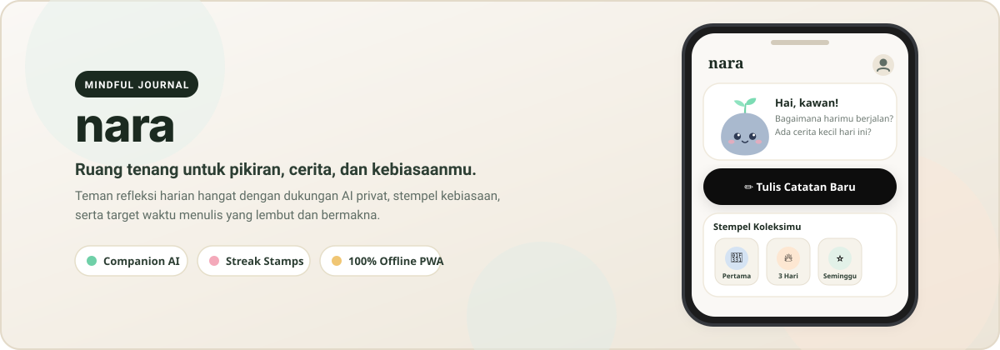
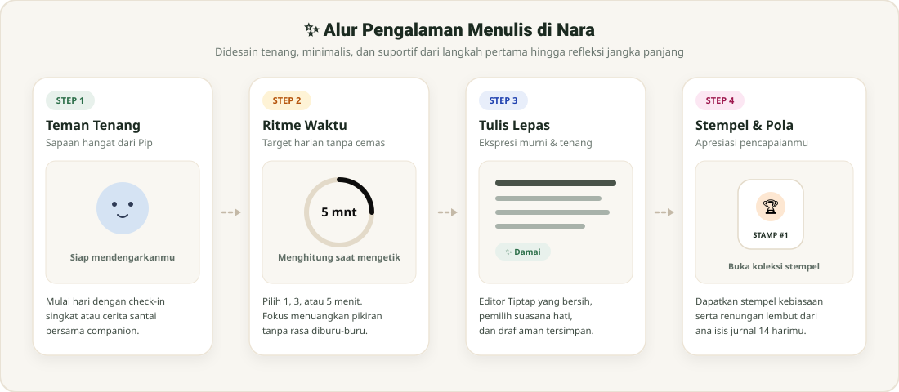

<p align="center">
  
</p>

<p align="center">
  <strong>Ruang aman, tenang, dan bersahabat untuk menuangkan pikiran, cerita, dan merawat kebiasaan baikmu.</strong>
</p>

<p align="center">
  <a href="#-fitur-utama"></a>
  <a href="#-arsitektur--teknologi"></a>
  <a href="#-arsitektur--teknologi"></a>
  <a href="#-arsitektur--teknologi"></a>
  <a href="#-antarmuka--desain"></a>
</p>

---

## 🌿 Tentang Nara

**Nara** adalah aplikasi jurnal kesehatan mental (*mindful journaling*) mobile-first yang didesain secara khusus untuk menghadirkan rasa tenang, bebas cemas, dan dekat. Terinspirasi oleh estetika minimalis hangat (*cozy, warm palette, companion-led*), Nara menyingkirkan tekanan menulis berlebihan dan menggantinya dengan:

1. **Teman Pendamping Hangat (Companion AI):** Pip (dan kawan-kawan) yang siap mendengarkan tanpa menghakimi, mendiagnosis, atau menggurui.
2. **Ritme Waktu Harian (*Daily Rhythm*):** Target waktu santai (1, 3, atau 5 menit) yang hanya menghitung saat kamu aktif mengetik — tanpa hitung mundur yang memicu stres.
3. **Stempel Pencapaian (*Habit Stamps*):** Koleksi prangko retro dengan ilustrasi unik untuk mengapresiasi setiap langkah kecilmu.
4. **Offline-First & Terenkripsi Privat:** Tetap dapat digunakan saat offline dengan sinkronisasi otomatis, serta keamanan data dengan PostgreSQL Row Level Security (RLS).

---

## 📱 Tampilan & Alur Aplikasi

<p align="center">
  
</p>

---

## ✨ Fitur-Fitur Utama

### 1. 🧸 Teman Pendamping (*Companion AI*)
* Pilih karakter pendamping favoritmu: **Pip** (batu bersemi), **Dew** (tetesan embun), **Moss** (lumut teduh), **Sandy**, atau **Shelly**.
* Menggunakan LLM cerdas yang dioptimalkan dengan instruksi kepribadian suportif, hangat, dan aman.
* **Fitur Insights:** Menganalisis pola emosi 14 hari terakhir secara berkala untuk memberikan renungan yang menenangkan.

### 2. ⏱️ Penghitung Waktu Target Ramah (*Smart Target Timer*)
* Menghilangkan rasa was-was stopwatch biasa.
* Menggunakan logika **Active Typing Detection**: waktu hanya bertambah ketika pengguna aktif mengetik catatan.
* Pilihan target 1, 3, atau 5 menit sesuai kenyamanan pengguna.

### 3. 🏷️ Stempel Apresiasi (*Stamps & Gamification*)
* Dapatkan stempel ilustrasi cantik saat menulis catatan pertama, mempertahankan *streak* 3 hari, seminggu penuh, atau mencapai milestone catatan tertentu.
* Kartu koleksi dirancang dengan gaya prangko pos vintage yang responsif dan mendukung tampilan **Dark Mode** elegan.

### 4. 📝 Editor Jurnal Bersih (*Tiptap Rich Editor*)
* Didukung oleh ekstensi Tiptap: formatting sederhana, hitungan kata/karakter, template refleksi harian (*Gratitude, Brain Dump, Daily Reflection*).
* Pemilih emosi (*Mood Picker*) berbasis ilustrasi SVG kustom.

### 5. 🌐 Aksesibilitas & Personalisasi Penuh
* **Dukungan Bilingual:** Bahasa Indonesia (ID) & English (EN).
* **Mode Tampilan:** Tema Terang (*Warm Off-White*), Gelap (*Deep Slate*), atau mengikuti sistem perangkat.
* **Navigasi Terpusat:** Pengaturan akun dan preferensi terintegrasi rapi di halaman profil pengguna (`/profile`).

---

## 🛠️ Arsitektur & Teknologi

| Komponen | Teknologi | Keterangan |
| :--- | :--- | :--- |
| **Frontend Framework** | Next.js 15 (App Router) + React 18 | SSR, Dynamic Routing, Server Actions |
| **Styling & Design** | Tailwind CSS + Framer Motion | Animasi spring halus, font Recoleta & Inter |
| **State & Data Fetching**| TanStack Query v5 | Sinkronisasi data real-time & caching efisien |
| **Database & Auth** | Supabase (PostgreSQL + RLS) + NextAuth | Otorisasi aman, login multi-metode |
| **AI Integration** | Groq API (`qwen/qwen3.8-27b`) | Respon cepat, hemat latensi, persona empatik |
| **PWA & Offline** | Serwist Service Worker | Kemampuan instalasi di layar utama & offline |
| **Rich Text Editor** | Tiptap (Headless Editor) | Ekstensibel, ringan, dan ramah mobile |

---

## 🚀 Memulai (Panduan Instalasi Lokal)

### 1. Prasyarat
* Node.js versi 18+ atau 20+
* Akun [Supabase](https://supabase.com) (atau stack Supabase lokal via Docker)
* Kunci API [Groq Console](https://console.groq.com)

### 2. Clone Repositori
```bash
git clone https://github.com/albetsurya/nara-app.git
cd nara-app
```

### 3. Pasang Dependensi
```bash
npm install
```

### 4. Konfigurasi Lingkungan (*Environment Variables*)
Salin file `.env.example` ke `.env.local`:
```bash
cp .env.example .env.local
```
Lengkapi variabel berikut di dalam `.env.local`:
```env
NEXT_PUBLIC_SUPABASE_URL=https://<your-project-id>.supabase.co
NEXT_PUBLIC_SUPABASE_ANON_KEY=eyJhbGciOi...
SUPABASE_SERVICE_ROLE_KEY=eyJhbGciOi...

# AI Model
GROQ_API_KEY=gsk_...
GROQ_MODEL=qwen/qwen3.8-27b

# NextAuth (Opsional jika menggunakan Google OAuth NextAuth)
NEXTAUTH_URL=http://localhost:3000
NEXTAUTH_SECRET=your_nextauth_secret_key
GOOGLE_CLIENT_ID=your_google_client_id
GOOGLE_CLIENT_SECRET=your_google_client_secret
```

### 5. Setup Database Supabase
Jalankan skrip migrasi yang terdapat di `supabase/schema.sql` pada SQL Editor Supabase Anda untuk membuat:
* Tabel `profiles`, `journals`, dan `stamps`.
* Fungsi pemicu (*triggers*) untuk pendaftaran otomatis dan pemberian stempel.
* Kebijakan *Row Level Security* (RLS) untuk isolasi data tiap pengguna.

### 6. Jalankan Aplikasi
```bash
# Jalankan mode pengembangan
npm run dev

# Atau jalankan build produksi & uji coba PWA
npm run build
npm start
```
Buka peramban di [http://localhost:3000](http://localhost:3000).

---

## 📁 Struktur Direktori

```text
nara/
├── public/
│   ├── assets/              # Banner SVG & diagram alur fitur aplikasi
│   ├── icons/               # Ikon PWA (maskable, favicon, SVG)
│   └── manifest.json        # Konfigurasi instalasi PWA
├── src/
│   ├── app/                 # Next.js App Router
│   │   ├── (app)/           # Halaman utama terproteksi (home, journal, profile, stamps, chat)
│   │   ├── api/             # API routes (chat AI, insights, sync auth)
│   │   ├── auth/            # OAuth & callback handler
│   │   ├── login/           # Halaman masuk & registrasi
│   │   └── onboarding/      # 6 layar alur onboarding (gaya milo)
│   ├── components/
│   │   ├── home/            # Kartu beranda (HomeView, StampsPreview, OnThisDay)
│   │   ├── journal/         # Tiptap RichEditor, TimerDial, MoodPicker, DailyPrompt
│   │   ├── pip/             # Aset karakter ilustrasi SVG kustom & animasi
│   │   └── ui/              # Komponen atomik (BottomNav, LocaleSwitch, ThemeToggle)
│   ├── lib/                 # Query helpers, i18n dictionary, Supabase client, stamps logic
│   └── middleware.ts        # Proteksi rute & refresh sesi token
├── supabase/
│   └── schema.sql           # Skema database, trigger, & aturan RLS
└── README.md
```

---

## 🔒 Privasi & Keamanan

* **Zero Data Leakage:** Kunci rahasia API (Groq/Anthropic) hanya dieksekusi di Server-side route handler Next.js dan tidak pernah dikirim ke browser klien.
* **Row Level Security (RLS):** Supabase RLS memastikan pengguna hanya memiliki akses baca/tulis terhadap data catatan dan stempel milik mereka sendiri.
* **Sanitasi Konten:** Seluruh input catatan dibersihkan dan disanitasi sebelum disimpan ke basis data.

---

## 📄 Lisensi

Didistribusikan di bawah lisensi MIT. Lihat berkas `LICENSE` untuk informasi lebih lanjut.

<p align="center">
  Dibuat dengan rasa tenang dan kehangatan 🌿 <strong>Nara App</strong>
</p>
